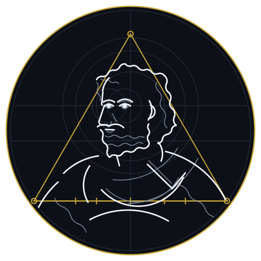

:site_title: Aristotle of Stagira

.. container:: author-overline

   semantic digital archive • the works of

.. _loci-geometrici:

====================
Aristotle of Stagira
====================

The mission of this project is to capture a semantic digital library of the works of :person:`Aristotle of Stagira <aristotle>` (384–322 BC), whose foundational treatises on logic, physics, psychology, and metaphysics established the architecture of demonstrative science (*apodeixis*), continuous quantity, potential infinity, imaginative construction (*phantasma*), and intelligible matter (*hyle noete*). Within the interconnected `GEOMETOR <https://geometor.com/books/>`_ semantic digital archive, these works are liberated from static print bounds—decomposed into addressable semantic units, calibrated vector diagrams, primary-source citation provenance, and cross-corpus citations speaking one shared geometric language.

.. reference-directory::
   :sort: order

.. toctree::
   :hidden:
   :maxdepth: 2

   analytica_posteriora/index
   organon/index
   physica/index
   de_anima/index
   metaphysica/index
   concordance
   glossary
   people/index
   bibliography
   usage/index
   about/index
   log/index
   modules/index
